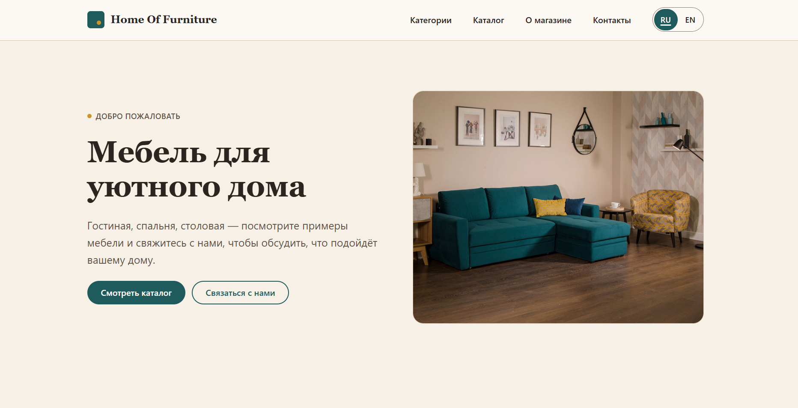
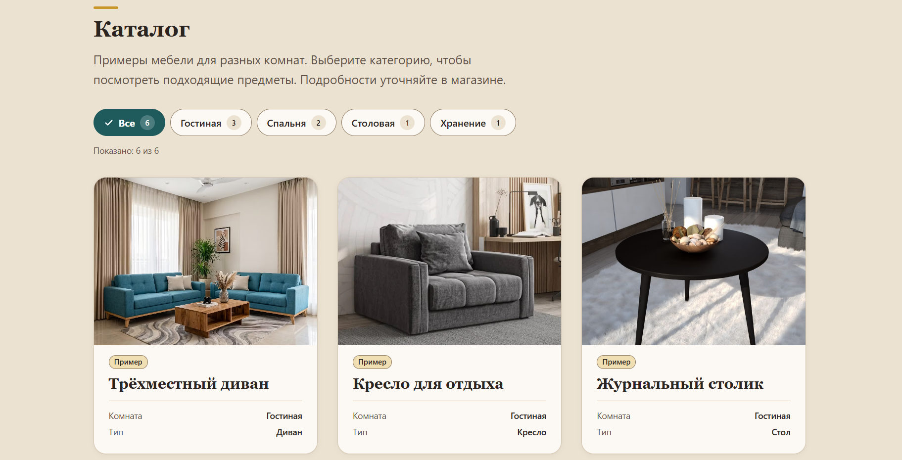

# Home Of Furniture

## Краткое описание

Сайт-визитка мебельного магазина. Показывает примеры мебели по комнатам и контакты для связи. Есть каталог с фильтром по категориям и переключение языка (русский / английский).

## Стек / Технологии

- React --> JS библиотека
- TypeScript --> типизация
- Vite --> сборщик
- CSS --> стили без фреймворков
- Vitest, Testing Library, Playwright --> тесты
- Lighthouse CI --> аудит производительности

## Запуск

### Локально

```bash
npm install
npm run dev
```

Приложение поднимется на `http://localhost:5173`. Нужен Node.js 22.22.2+ или 24.15+.

### Проверки

```bash
npm run lint       # ESLint
npm test           # модульные и компонентные тесты
npm run test:e2e   # E2E и доступность (перед первым запуском: npm run test:e2e:install)
npm run perf       # аудит производительности, подробнее — docs/performance.md
```

## Переменные окружения

Не требуются.

## Возможности

- **Категории:** гостиная, спальня, столовая и хранение; клик по категории открывает её в каталоге
- **Каталог:** карточки мебели с фильтром по категориям
- **Два языка:** русский и английский, выбор сохраняется в браузере
- **Контакты:** телефон и почта открываются в приложении для звонка и письма

<details>
<summary>Нажмите, чтобы посмотреть скриншоты</summary>


</details>
